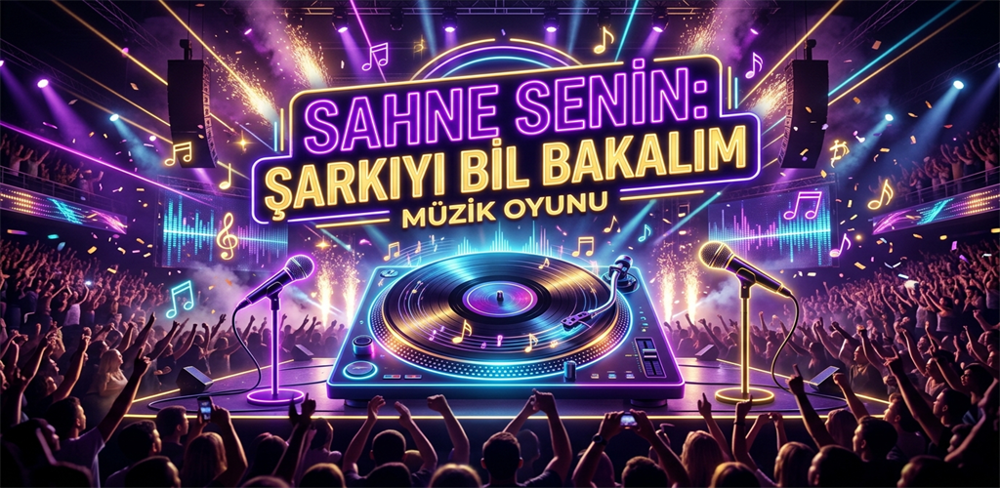

<div align="center">

# 🎵 Sahne Senin - Müzik Düellosu

**Müzik bilginize ne kadar güveniyorsunuz?**  
Türkiye'nin dört bir yanından müzikseverlerle canlı 1v1 düellolara katılın, şarkıyı en hızlı tahmin eden siz olun!

[](https://flutter.dev)
[](https://nodejs.org)
[](https://sqlite.org)
[](https://github.com/erd5334/muzik_duellosu)
[](https://github.com/erd5334/muzik_duellosu)

<br/>



</div>

---

## 🌟 Öne Çıkan Özellikler

### 🎵 Geniş ve Zengin Türkçe Müzik Arşivi
90'lar Türkçe Pop efsanelerinden 2000'ler hitlerine, Anadolu Rock klasiklerinden Türkçe Rap ve horon dolu Karadeniz türkülerine kadar binlerce şarkı parmaklarınızın ucunda.

### ⚔️ Canlı 1v1 Müzik Düelloları
- **Gerçek Rakipler:** Gerçek müzikseverlerle anlık canlı eşleşme.
- **Hızlı Tahmin:** Şarkıyı dinle, seçenekler arasından doğru şarkıyı veya sanatçıyı saniyeler içinde bil.
- **Hız Bonusu:** Hızlı cevap vererek ekstra kombo puanları topla, rakibini geride bırak!

### 👥 Arkadaşınla Özel Oda Oyna
Arkadaşını davet et, özel oda kodunu paylaş ve 5 ila 20 tur arasında kesintisiz, tamamen ücretsiz düello heyecanını yaşa!

### 🏆 Nostaljik Plak & Rozet Koleksiyonu
Kazandığın maçlardan altın ve plak parçaları topla; **Tarkan, Barış Manço, Sezen Aksu, Müslüm Gürses, Cem Karaca ve Kazım Koyuncu** gibi unutulmaz sanatçıların efsanevi Altın Plaklarını açarak profiline tak!

### 📊 Kariyer Karnesi & Sanatçı Ustaları
- **Kategori Karnesi:** 90'lar Pop, Rock, Rap, Arabesk ve Nostalji kategorilerinde galibiyet, mağlubiyet ve kazanma oranı istatistikleri.
- **Sanatçı Sıralaması:** En çok doğru bildiğin müzisyenlerin altın 🥇, gümüş 🥈 ve bronz 🥉 madalyalarla taçlandırıldığı ustalık karnesi.
- **Seri Takibi:** En iyi kazanma serisi (🔥 Best Streak) rekorları.

### ⚡ Enerji ve Jokerler
- Zorlandığın sorularda **50/50 jokerini** kullanarak yanlış iki şıkkı anında ele.
- Zamanla kendiliğinden dolan çevrimdışı enerji sistemiyle eğlenceye ara verme.

---

## 🛠️ Teknoloji Yığını (Tech Stack)

| Katman | Teknoloji / Kütüphane | Açıklama |
| :--- | :--- | :--- |
| **İstemci (Client)** | Flutter / Dart | Android & Web çapraz platform desteği |
| **Durum Yönetimi** | Provider | Reaktif veri ve state mimarisi |
| **Ses Motoru** | audioplayers | Düşük gecikmeli gerçek zamanlı önizleme |
| **Backend** | Node.js / ws | Gerçek zamanlı WebSocket düello sunucusu |
| **Veritabanı** | SQLite (`node:sqlite`) | Oyuncu profilleri, dinamik kategoriler ve plaklar |
| **Müzik Sağlayıcı** | Deezer API | Yüksek kaliteli şarkı önizlemeleri ve albüm kapakları |
| **Kimlik Doğrulama** | Google Sign-In & SQLite | Bulut yedeklemeli kalıcı oyuncu profili |

---

## 📁 Proje Dizin Yapısı

```bash
muzik_duellosu/
├── android/                 # Android yerel yapılandırmaları ve Gradle ayarları
├── lib/                     # Flutter uygulama kaynak kodları
│   ├── models/              # Kategori, Şarkı, Soru, Rozet ve Oyuncu İstatistik modelleri
│   ├── providers/           # GameProvider (Ekonomi, Enerji, Düello ve WebSocket)
│   ├── screens/             # Ana Menü, Eşleşme, Arena ve Maç Sonu ekranları
│   ├── services/            # Müzik API, Auth, Reklam ve Satın Alma servisleri
│   ├── theme/               # Mat obsidyen & Kehribar tasarım teması
│   └── widgets/             # Kariyer Dialog, Koleksiyon, Özel Oda, Mağaza vb.
├── play_store_assets/       # İkon, Tanıtım Görselleri ve Mağaza Varlıkları
├── server/                  # Canlı Çok Oyunculu Node.js Sunucusu & Web Admin Paneli
│   ├── server.js            # WebSocket & HTTP REST API motoru
│   └── admin.html           # Oyuncu moderasyonu & CMS yönetim paneli
└── YOL_HARITASI.md          # LiveOps, Sezon Bileti ve Reklam Stratejisi Rehberi
```

---

## 🚀 Kurulum & Çalıştırma

### 1. Mobil Uygulama (Flutter)
```bash
# Bağımlılıkları yükle
flutter pub get

# Cihazda veya emülatörde çalıştır
flutter run

# Google Play AAB paketi üret
flutter build appbundle --release
```

### 2. Canlı Sunucu (Backend)
```bash
cd server
npm install

# Geliştirme modunda başlat
node server.js

# VPS üzerinde PM2 ile arka planda çalıştırma
pm2 start server.js --name "muzik-duellosu"
```

---

## 🗺️ Büyük Yol Haritası (Roadmap)
Oyunun sonraki güncellemeleri için planlanan **%100 Admin Yönetimli Sezon Bileti (Müzik Pass)**, **Sonsuz Bonus Sandık**, **Günün Şarkısı**, **Haftalık Müzik Ligleri** ve **Sosyal Medya Reklam Stratejileri** hakkında detaylı bilgi için:

👉 **[YOL_HARITASI.md](YOL_HARITASI.md)** belgesini inceleyebilirsiniz.

---

<div align="center">

Müziğin ritmini yakala, hafızana güven ve şampiyonluk koltuğuna otur.  
**Sahne Senin!** 🎤🎸

Developed with ❤️ by [ER Yazılım](https://eryazilimci.com)

</div>
