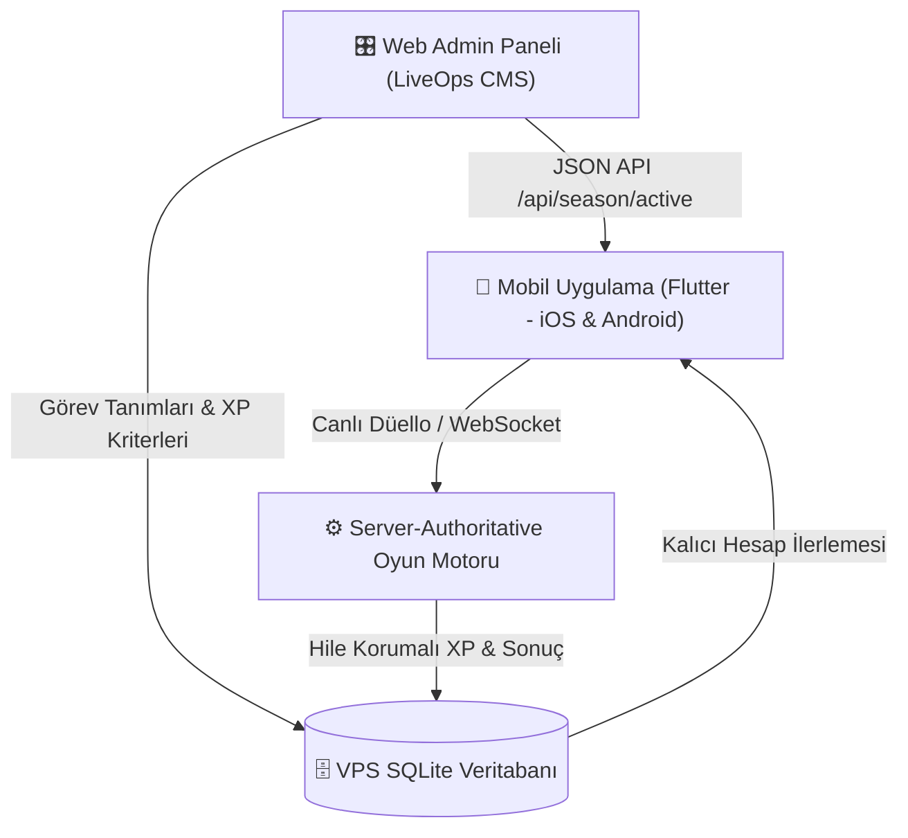
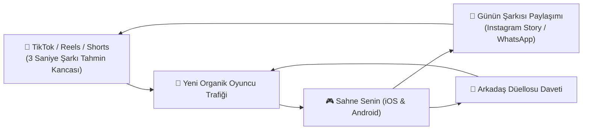
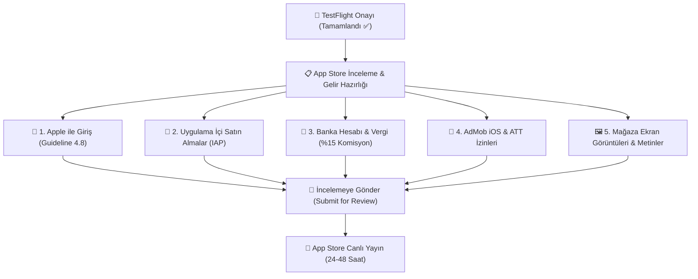

# 🗺️ MÜZİK DÜELLOSU / SAHNE SENİN: BÜYÜK YOL HARİTASI (ROADMAP)

Bu belge; uygulamanın ürün geliştirme, canlı operasyon (LiveOps), oyun mekanikleri, hile koruması, Apple App Store yayın süreci ve sosyal medya reklam stratejilerini tek bir çatı altında toplayan ana rehberdir.

---

## 📌 BÖLÜM 1: TAMAMLANANLAR (v1.0.7 KİLOMETRE TAŞI)

- [x] **Çevrimdışı Enerji Dolumu Düzeltmesi:** Uygulama kapalıyken geçen sürede dolan enerjinin sunucu senkronizasyonuyla ezilme sorunu kökten çözüldü. Artık her 12 dakikada 1 enerji kesin olarak doluyor ve sunucuya güvenle işleniyor.
- [x] **Kariyer & İstatistik Paneli:**
  - **Kategori Karnesi:** Her kategori için oynanan maç, galibiyet, mağlubiyet, beraberlik, kazanma oranı (%) ve doğru bilinen şarkı sayısı.
  - **Sanatçı Ustaları:** Düellolarda doğru bilinen her sanatçı için `+1` puanlama ve altın/gümüş/bronz madalyalı sıralama tablosu.
  - **En İyi Seri (🔥 Streak):** Kesintisiz galibiyet serisi takibi.
  - **Bulut Senkronizasyonu:** VPS SQLite veritabanına `stats_json` ve `last_energy_timestamp` entegrasyonu, Google hesabı ile cihazlar arası kayıpsız birleştirme (`mergeStats`).
- [x] **Apple iOS TestFlight Altyapısı (23 Ekim 2026):**
  - Apple Developer hesabı ve App Store Connect kaydı (`com.eryazilimci.muzikDuellosu`).
  - GitHub Actions bulut Mac (`macos-26`) otomatik derleme ve dağıtım CI/CD altyapısı.
  - Fiziksel iPhone üzerinde TestFlight ile canlı kurulum ve test.
  - iOS ses akış mimarisi düzeltmesi (Apple `AVPlayer` yerel CDN akışı ve ana hoparlöre ses yönlendirmesi).

---

## 🚀 BÖLÜM 2: OYUN GELİŞTİRME & LIVEOPS (CANLI OPERASYON) YOL HARİTASI

> **Altın Kural:** Mobil uygulama sadece sahnedir; tüm ödüller, sezonlar, süreler ve oranlar **Admin Panelinden dinamik olarak yönetilmeli**, Google Play'e veya App Store'a sık sık güncelleme atılmamalıdır.

---

### FAZ 1: DİNAMİK SEZON BİLETİ (MÜZİK PASS) & GÖREV SİSTEMİ

#### 1. 🎟️ %100 Admin Panelinden Yönetilen Sezon Bileti
- **Sıfır Güncelleme:** Sezon adı, başlangıç/bitiş tarihi, katman sayısı (1-20) ve her katmanın ödülleri web admin panelinden tek tıkla belirlenir.
- **Çift Hat:** Ücretsiz Yol (Free Pass) ve Pro/VIP Yol (Gold Pass).
- **Ödül Tipleri:** Altın paketleri, %50 Jokerleri, Özel Sanatçı Plak Parçaları, Profil Çerçeveleri.

#### 2. 🎁 Sonsuz Bonus Sandık (Endgame Loop - 20+ Seviye)
- Sezon biletini erkenden bitiren hırslı oyuncuların oyunu bırakmasını engellemek için:
  - 20. katmandan sonra her `500 XP`de bir **"Sonsuz Plak Sandığı"** açılır.
  - Sandıktan rastgele altın, joker ve sürpriz plak parçaları çıkar (sınır yoktur).
  - Oyuncunun seviyesi `Seviye 20 + 8 ⭐` şeklinde artmaya devam ederek hava atma (statü) sağlar.

#### 3. 🎯 Görev Hiyerarşisi (Oturum Süresini Artırma)
- **⚡ Günlük Görevler (Her gece 00:00'da yenilenir):**
  - *"3 düello tamamla"* (+100 XP)
  - *"Anadolu Rock'ta 1 galibiyet al"* (+150 XP)
  - *"Tüm günlük görevleri bitir"* (+150 XP & 50 Altın bonus)
- **🗓️ Haftalık Görevler (Her Pazartesi yenilenir):**
  - *"90'lar Pop'ta Tarkan'dan 5 şarkı bil"* (+500 XP) ➔ *Oyuncuyu Tarkan şarkısı yakalamak için peş peşe maç atmaya teşvik eder.*
  - *"Hafta boyunca 15 galibiyet al"* (+600 XP)
- **🏆 Sezonluk Büyük Görevler (30 Gün Boyunca Aktif):**
  - *"Tüm kategorilerde en az 5 galibiyet al"* (+1500 XP)
  - *"Toplam 100 düello tamamla"* (+2000 XP)

#### 4. 💿 Plak Dönüşüm & Joker Parça Sistemi
- Bir sanatçının plak koleksiyonunu (Bronz, Gümüş, Altın, Elmas) tamamen bitiren oyuncunun kazandığı fazlalık parçalar çöp olmaz.
- Fazla parçalar **"Joker Plak Parçası"**na veya **"Plak Tozu"**na dönüştürülerek eksik kalan diğer sanatçıların plaklarında kullanılabilir.

---

### FAZ 2: SOSYAL VİRALİTE & BÜYÜK ETKİNLİKLER

#### 1. 🌟 "Günün Şarkısı" Modu (Heardle / Wordle Tarzı)
- Her gün tüm Türkiye için aynı 1 adet gizemli şarkı.
- Oyuncu önce 1 saniye dinler; bilemezse 2 saniye, 4 saniye açılır.
- **Viral Paylaşım Butonu:** Tek tıkla Instagram Story / WhatsApp görseli üretilir:
  > *"Günün Şarkısını 2. saniyede bildim! 🎵🟩🟩⬜⬜ Sen bilebilir misin?"*
- Her sabah kullanıcıların uygulamayı açması için en güçlü organik büyüme aracıdır.

#### 2. 🏆 Haftalık Ligler & Sıralama (Leaderboard)
- Bronz Lig ➔ Gümüş Lig ➔ Altın Lig ➔ Elmas Lig ➔ Efsaneler Ligi.
- Pazar gecesi grubunda ilk 3'e girenler lig atlar ve ödül kazanır.
- Şehir bazlı gurur tablosu: *"İzmir 1.si"*, *"Ankara 3.sü"*.

#### 3. 👥 Çok Kişilik Parti Modu (3-8 Kişi)
- Özel oda açarak 4-5 arkadaşın aynı anda yarışabilmesi.
- Şarkı çalar, ilk doğru basan turu kazanır. Arkadaş ve kafe ortamlarının vazgeçilmezi.

#### 4. 🎖️ Prestij Unvanları
- Tarkan'dan 50 doğru: **"Megastar Fanatiği"** 🌟
- 90'lar Pop'ta %80 galibiyet: **"90'lar Efsanesi"** 📻
- Arabesk'te 30 galibiyet: **"Damar Üstadı"** 👑

---

### FAZ 3: HİLE KORUMASI (ANTI-CHEAT) & MAÇTAN KAÇMA YÖNETİMİ

#### 1. 🔌 Hükmen Mağlubiyet & Terk Yönetimi
- **Oyunda Kalan (Dürüst Oyuncu):** Ekranda *"Rakip Oyundan Kaçtı - Hükmen Galip Geldin!"* kutlaması açılır; tam galibiyet puanı, altın ve plak parçası eksiksiz verilir.
- **Oyunu Terk Eden (Kaçan):** Maça girerken verdiği 1 enerjisi yanar, karnesine +1 Mağlubiyet yazılır, kazanma serisi (🔥) sıfırlanır. 1 saatte 3 kez terk edene 5 dakika maç yasağı (cooldown) uygulanır.

#### 2. 🛡️ Server-Authoritative Güvenlik
- **XP ve Seviyeyi Yalnızca VPS Sunucusu Hesaplar:** Telefon hafızasındaki dosyaları değiştirerek veya Lucky Patcher/GameGuardian ile hile yapılamaz.
- **Cevaplar İstemcide Durmaz:** Doğru cevabın hangisi olduğunu telefon bilmez; seçenek metinleri gelir, basılan şık sunucuya iletilir, kontrol sunucuda yapılır.
- **Süre Sunucuda Çalışır:** Telefon saatini dondurma hilesi geçersizdir.
- **Bot/Refleks Hilesi Tespiti:** 50 milisaniye gibi insanüstü hızla basılan şüpheli cevaplar sunucuda loglanır, admin paneline otomatik bayrak düşürülür.

---

### FAZ 4: YENİ POPÜLER KATEGORİLER
- 🎬 **Dizi & Film Müzikleri:** Kurtlar Vadisi, Ezel, Aşk-ı Memnu, Hababam Sınıfı, Yeşilçam klasikleri.
- 🇹🇷 **Eurovision Türkiye:** Sertab Erener, Manga, Athena, Şebnem Paker, Mor ve Ötesi.
- 🎸 **2000'ler Türkçe Rock & Alternatif:** Duman, Şebnem Ferah, Teoman, Hayko Cepkin.

---

### FAZ 5: GAME FEEL, JUICE & OYUN PSİKOLOJİSİ (Gamedev-Skills Reposu Kancaları)

Oyun geliştirme ajan reposundan (`awesome-gamedev-agent-skills`) ilham alarak oyuna eklenecek "tatmin ve bağımlılık" mekanikleri:

#### 1. ⚡ Hissiyat & Tatmin (Juice - Dopamin Patlaması)
- **Haptic Feedback (Dokunsal Titreşim):** 
  - Doğru cevap tıklandığında iOS & Android motorundan gelen hafif, tok ve tatmin edici dokunuş hissi.
  - Yanlış cevapta çift uyarıcı hafif titreşim.
  - Maç kazanıldığında görkemli zafer titreşimi.
- **Micro-Particle & Işık Efektleri:** 
  - Doğru basılan şıkkın etrafından altın/yeşil konfeti veya yıldız parçacıklarının patlaması.
- **Tansiyon & Gerilim Mekaniği:** 
  - Sürenin son 3 saniyesine girildiğinde sayaç dairesinin kırmızıya dönüp kalp atışı gibi nabız (pulse) atması ve ritmik sayaç uyarısı.
- **🔥 Alevli Combo Çarpanı:** 
  - 2, 3 ve 5 seri doğru bilindiğinde puan çarpanının (x1.5, x2) ekranda alevli görsel efektle büyümesi.

#### 2. 🧠 Oyun Psikolojisi & Retention (Oyuncuyu Bağlama)
- **"Çok Yakındın!" (Near Miss) Psikolojisi:** 
  - 1-2 puan farkla kaybedilen maçlarda oyuncuyu küstürmek yerine hırslandıran *"Çok yaklaştın! Rövanş maçı başlat"* dinamik butonu.
- **Teselli Ödülü:** 
  - Mağlup olan oyuncunun tamamen sıfır çekip oyundan soğumasını önlemek için küçük bir teselli XP'si / 10 altın verilmesi.
- **FTUE (İlk Kullanıcı Deneyimi):** 
  - Oyunu ilk kez kuran oyuncunun ilk maçında hızlı doğru bilip kazanma hazzını tatması (onboarding akışı).

---

## 📢 BÖLÜM 3: REKLAM, TANITIM & VİRAL BÜYÜME STRATEJİSİ

---

### 1. 🏢 Hesap Stratejisi: Kişisel Hesap mı, Özel Hesap mı?
- **Ana Karar:** Uygulama için müstakil bir **@muzikduellosu** (veya @sahnesenin) resmi marka hesabı açılmalıdır.
- **Kişisel Hesap / eryazilimci.com Rolü:** Kişisel hesap ve web sitesi **"Geliştirici & Güven Damgası"** olarak kullanılmalı; profilde *"Bir ER Yazılım projesidir - eryazilimci.com"* ibaresi yer almalıdır. Bu, hem kurumsal güven sağlar hem de diğer yazılım projelerine trafik taşır.

---

### 2. 🎬 İçerik & Video Formatları (Reels, TikTok, Shorts)

#### Format A: "3 Saniyede Şarkıyı Bilebilecek misin?" (En Yüksek Etkileşim)
- Video şarkının ilk 3 saniyesiyle başlar (Tarkan, Müslüm Gürses, Duman vb.).
- Ekranda büyük yazı: *"Bu şarkıyı ilk 3 saniyede bilen gerçek 90'lar çocuğudur!"*
- 3 saniye sonra ses kesilir, geri sayım başlar (3, 2, 1).
- Yorum kancası: *"Bildiysen yoruma adını yaz, bilemediysen uygulamada kapışalım!"* ➔ **Algoritma yorum patlaması yüzünden videoyu keşfete iter.**

#### Format B: İkili Kapışma / Arkadaş Düellosu
- İki kişinin telefonu ellerine alıp yan yana yarışırken çekilmiş 15 saniyelik doğal reaksiyon videosu.
- Biri son saniyede doğru basıp havalara uçar, diğeri masaya vurur.
- Başlık: *"Arkadaş ortamında arkadaşlığı bitiren o an 😂 Sahne Senin yayında!"*

#### Format C: Nesiller Kapışması (Nostalji Kancası)
- *"Annem vs Ben: Yeşilçam şarkılarını kim daha hızlı bilecek?"* veya *"2000'ler Pop düellosunda kim kimi yener?"*

---

### 3. 🎯 Takipçi Kasma & Oyuncu Kazanma Taktikleri
1. **Bio Linki:** Profil bio'sunda doğrudan mağaza indirme linki (linktree üzerinden tek linkle App Store & Google Play).
2. **Haftalık Skor Meydan Okuması:** *"Bu hafta 90'lar Pop'ta 10 galibiyet serisi yapıp ekran görüntüsünü DM atan ilk 3 kişiye 1000 Altın + VIP hediye!"*
3. **Müzik Mizahı / Meme İçerikleri:** Türk müziği, nostaljik klipler ve şarkı sözleri üzerine eğlenceli caps ve paylaşımlar.
4. **Mikro-Influencer İşbirlikleri:** 10 bin - 50 bin takipçili müzik/nostalji sayfalarıyla küçük bütçeli story paylaşımları.

---

## 🍏 BÖLÜM 4: APPLE APP STORE (iOS) YAYINA ÇIKIŞ VE TİCARİLEŞME YOL HARİTASI

TestFlight üzerinde fiziksel iPhone testi başarıyla tamamlanmıştır. Uygulamanın doğrudan App Store genel kullanıcılarına açılması ve gelir üretmesi için gereken tüm adımlar aşağıdadır:

---

### 1. 🔑 Apple ile Giriş (Sign in with Apple) Kuralı
- **Apple İnceleme Yönergesi (Guideline 4.8):** Uygulamada Google gibi 3. taraf sosyal giriş seçeneği bulunduğu için, Apple iOS kullanıcılarına eşdeğer olarak "Apple ile Giriş" seçeneğinin sunulmasını zorunlu tutar.
- **İki Uygulama Seçeneği:**
  - **Seçenek A (Önerilen & Uzun Vadeli):** `sign_in_with_apple` paketi eklenir. iPhone kullanıcıları FaceID / TouchID ile tek tıkla şifresiz giriş yapar. Apple ID sunucudaki SQLite veritabanı ile senkronize edilir.
  - **Seçenek B (Hızlı Onay Yolu):** İlk sürümde iOS üzerinde sosyal hesap bağlama butonu gizlenerek yalnızca "Misafir Oyuncu" moduyla başlatılır; bu durumda Apple ile Giriş zorunluluğu doğmaz ve ilk onay bürokrasisiz alınır.

---

### 2. 💎 Uygulama İçi Satın Almalar (In-App Purchases)
- **Teknik Durum:** Kod tarafı (`lib/services/purchase_service.dart`) hem Android Google Play Billing hem de iOS StoreKit ile çift yönlü %100 uyumludur.
- **App Store Connect Tanımları:** App Store Connect > *Monetization > In-App Purchases* ekranında aşağıdaki ürünler açılacaktır:
  - **Tüketilebilir Ürünler (Consumables):**
    - Enerji Paketleri: `energy_10`, `energy_25`, `energy_60`, `energy_150`, `energy_300`
    - Altın/Elmas Paketleri: `coins_500`, `coins_1500`, `coins_4000`, `coins_10000`
  - **Tüketilemez Ürünler (Non-Consumable):**
    - Reklam Kaldırma: `remove_ads` (Apple kuralı gereği ayarlarda "Satın Alımları Geri Yükle / Restore Purchases" butonu aktif edilmiştir).
  - **Abonelik (Auto-Renewable Subscription):**
    - VIP Üyelik: `vip_club`

---

### 3. 🏦 Banka Hesabı, Vergi Anlaşması & Komisyon İndirimi
- **Banka Tanımlama (IBAN):** App Store Connect > *Agreements, Tax, and Banking* bölümünden Türk bankası IBAN ve SWIFT kodu tanımlanır. Apple kazançları her ay doğrudan Türk banka hesabınıza havale eder.
- **W-8BEN ABD Vergi Formu:** Türkiye ile ABD arasındaki çifte vergilendirmeyi önleme anlaşması gereği form online doldurulur (gelir vergisi stopajı %0 veya minimuma iner).
- **Apple Küçük İşletme Programı (Small Business Program):** Yıllık geliri 1 milyon doların altındaki geliştiriciler için Apple standart %30 komisyonunu **%15'e indirmektedir**. Başvuru tek tıkla yapılarak net gelir %15 artırılacaktır.

---

### 4. 📢 AdMob (iOS Reklamları & Gelir)
- **AdMob iOS Kimliği:** Google AdMob konsolunda iOS için "Sahne Senin" uygulaması açılıp gerçek reklam birim ID'leri (Banner, Geçiş, Ödüllü) bağlanacaktır.
- **App Tracking Transparency (ATT):** iOS 14+ zorunluluğu gereği `NSUserTrackingUsageDescription` izni eklenecek; kullanıcıdan izin alınarak reklam BGBM (gelir) oranları maksimize edilecektir.
- **SKAdNetworkItems:** Apple reklam ilişkilendirme listesi `Info.plist` içine eksiksiz eklenecektir.

---

### 5. 👥 Çok Oyunculu Sunucu (iOS & Android Ortak Havuz)
- iOS kullanıcıları ile Android kullanıcıları VPS üzerindeki `server/bin/server.dart` WebSocket sunucusunda aynı canlı odalarda düello yapabilir.
- Platformlar arası (Cross-Platform) arkadaşlık davet kodları iki işletim sisteminde de ortak çalışacaktır.

---

### 6. 🖼️ Mağaza Sayfası ve İncelemeye Gönderme (App Store Review)
- **Ekran Görüntüleri:** TestFlight yüklü iPhone'dan alınacak 3-5 adet kaliteli ekran görüntüsü (Arena, Düello, Sanatçı Seçimi, Şarkı Çalma).
- **Mağaza Bilgileri:**
  - **Uygulama Adı:** Sahne Senin: Şarkıyı Bil
  - **Alt Başlık:** Müzik Düellosu & Şarkı Yarışması
  - **Kategori:** Oyunlar / Trivia (Bilgi) & Müzik
  - **Yaş Sınırı:** 4+ (veya 9+)
  - **Gizlilik Politikası URL'si:** Barındırılan privacy policy linki.
- **İnceleme ve Canlı Yayın:** "Submit for Review" butonuna basıldıktan sonra Apple App Review ekibi **24 ila 48 saat** içinde incelemeyi tamamlar ve uygulama tüm dünyada App Store'da indirilebilir hale gelir.

---

## 📋 ÖZET YOL HARİTASI TABLOSU

| Öncelik | Özellik / Strateji | Tip | Durum |
| :---: | :--- | :--- | :--- :--- |
| 🟢 P0 | Çevrimdışı Enerji Düzeltmesi & İstatistik Paneli | Oyun İçi | **Tamamlandı (v1.0.7)** |
| 🟢 P0 | Apple Developer, Mac CI/CD & TestFlight Kurulumu | Altyapı | **Tamamlandı ✅ (23 Ekim 2026)** |
| 🟢 P0 | iOS Ses Oynatma & Hoparlör Akış Düzeltmesi | iOS Çekirdek | **Tamamlandı ✅ (Build 5)** |
| 🟡 P1 | Apple ile Giriş (Sign in with Apple) Entegrasyonu | iOS / Hesap | **Sıradaki Adım (Guideline 4.8)** |
| 🟡 P1 | App Store Connect IAP Paketleri & Fiyat Tanımları | Monetization | **Sıradaki Adım** |
| 🟡 P1 | Agreements, Tax (W-8BEN) & %15 Küçük İşletme İndirimi | Finans / Banka | **Sıradaki Adım** |
| 🟡 P1 | %100 Admin Yönetimli Sezon Bileti & Sonsuz Sandık | LiveOps | **Sıradaki Adım** |
| 🟡 P1 | Günlük, Haftalık ve Sezonluk Görev Sistemi | Canlı Operasyon | **Sıradaki Adım** |
| 🟡 P1 | Hükmen Galibiyet & Terk Edeni Cezalandırma | Anti-Cheat | **Sıradaki Adım** |
| 🟡 P1 | Game Feel, Haptic & Juice (Titreşim, Parçacık, Nabız) | UX / Hissiyat | **Planlandı (Faz 5)** |
| 🔵 P2 | Günün Şarkısı (Wordle / Heardle Viral Modu) | Büyüme / Viral | Planlandı |
| 🔵 P2 | TikTok & Instagram Reels İçerik Yayını | Pazarlama | Başlatılacak |
| 🟣 P3 | Haftalık Ligler (Bronz'dan Şampiyonlar Ligi'ne) | Rekabet | Planlandı |
| 🟣 P3 | 3-8 Kişilik Çok Oyunculu Parti Modu | Sosyal | Planlandı |
| 🚀 P0 | App Store Nihai Gönderim (Submit for Review) | Mağaza | TestFlight Sonrası |

---
*Son Güncelleme: 23 Ekim 2026 • Sahne Senin / Müzik Düellosu Ekibi*
