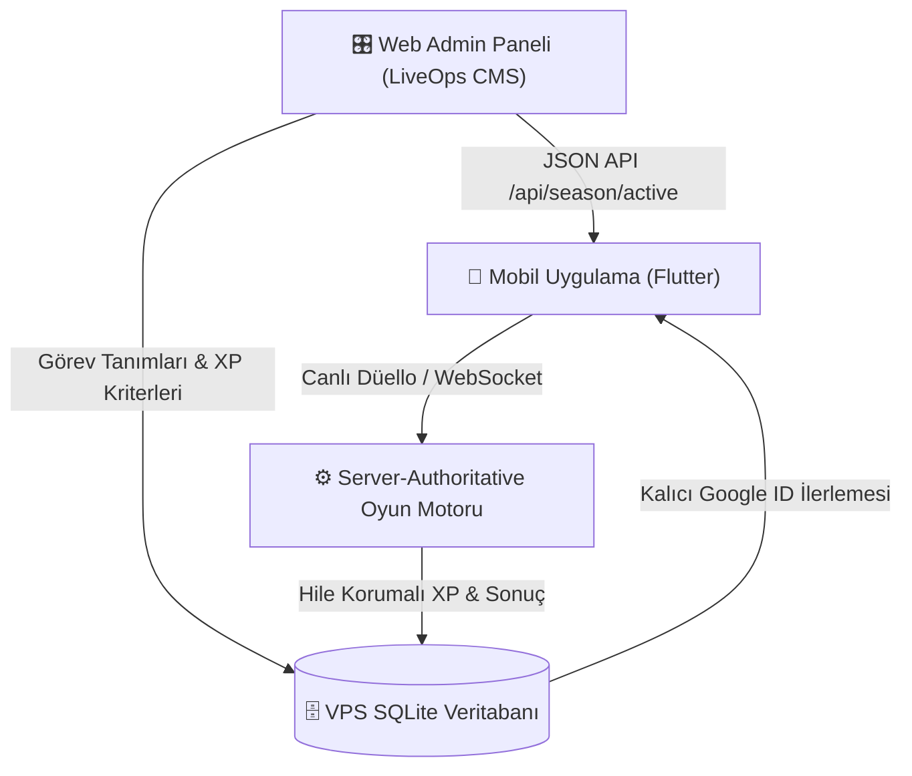
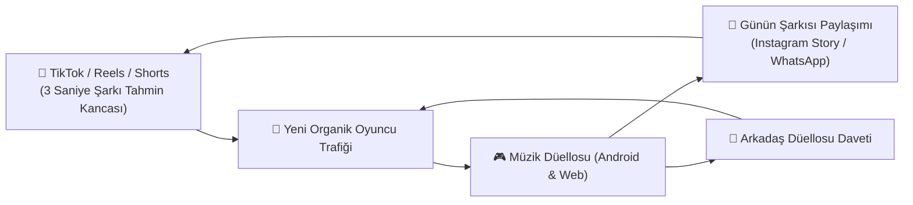

# 🗺️ MÜZİK DÜELLOSU / SAHNE SENİN: BÜYÜK YOL HARİTASI (ROADMAP)

Bu belge; uygulamanın ürün geliştirme, canlı operasyon (LiveOps), oyun mekanikleri, hile koruması ve sosyal medya reklam stratejilerini tek bir çatı altında toplayan ana rehberdir.

---

## 📌 BÖLÜM 1: TAMAMLANANLAR (v1.0.7 KİLOMETRE TAŞI)

- [x] **Çevrimdışı Enerji Dolumu Düzeltmesi:** Uygulama kapalıyken geçen sürede dolan enerjinin sunucu senkronizasyonuyla ezilme sorunu kökten çözüldü. Artık her 12 dakikada 1 enerji kesin olarak doluyor ve sunucuya güvenle işleniyor.
- [x] **Kariyer & İstatistik Paneli:**
  - **Kategori Karnesi:** Her kategori için oynanan maç, galibiyet, mağlubiyet, beraberlik, kazanma oranı (%) ve doğru bilinen şarkı sayısı.
  - **Sanatçı Ustaları:** Düellolarda doğru bilinen her sanatçı için `+1` puanlama ve altın/gümüş/bronz madalyalı sıralama tablosu.
  - **En İyi Seri (🔥 Streak):** Kesintisiz galibiyet serisi takibi.
  - **Bulut Senkronizasyonu:** VPS SQLite veritabanına `stats_json` ve `last_energy_timestamp` entegrasyonu, Google hesabı ile cihazlar arası kayıpsız birleştirme (`mergeStats`).

---

## 🚀 BÖLÜM 2: OYUN GELİŞTİRME & LIVEOPS (CANLI OPERASYON) YOL HARİTASI

> **Altın Kural:** Mobil uygulama sadece sahnedir; tüm ödüller, sezonlar, süreler ve oranlar **Admin Panelinden dinamik olarak yönetilmeli**, Google Play'e sık sık güncelleme atılmamalıdır.

---

### FAZ 1: DİNAMİK SEZON BİLETİ (MÜZİK PASS) & GÖREV SİSTEMİ

#### 1. 🎟️ %100 Admin Panelinden Yönetilen Sezon Bileti
- **Sıfır Güncelleme:** Sezon adı, başlangıç/bitiş tarihi, katman sayısı (1-20) ve her katmanın ödülleri web admin panelinden tek tıkla belirlenir.
- **Çift Hat:** Ücretsiz Yol (Free Pass) ve Pro/VIP Yol (Gold Pass).
- **Ödül Tipleri:** Altın paketleri, %50 Jokerleri, Özel Sanatçı Plak Parçaları, Profil Çerçeveleri.

#### 2. 🎁 Sonsuz Bonus Sandık (Endgame Loop - 20+ Seviye)
- Sezon biletini erkenden bitiren hırslı oyuncuların oyunu bırakmasını engellemek için:
  - 20. katmandan sonra her `500 XP`de bir **"Sonsuz Plak Sandığı"** açılır.
  - Sandıktan rastgele altın, joker ve sürpriz plak parçaları çıkar (sınır yoktur).
  - Oyuncunun seviyesi `Seviye 20 + 8 ⭐` şeklinde artmaya devam ederek hava atma (statü) sağlar.

#### 3. 🎯 Görev Hiyerarşisi (Oturum Süresini Artırma)
- **⚡ Günlük Görevler (Her gece 00:00'da yenilenir):**
  - *"3 düello tamamla"* (+100 XP)
  - *"Anadolu Rock'ta 1 galibiyet al"* (+150 XP)
  - *"Tüm günlük görevleri bitir"* (+150 XP & 50 Altın bonus)
- **🗓️ Haftalık Görevler (Her Pazartesi yenilenir):**
  - *"90'lar Pop'ta Tarkan'dan 5 şarkı bil"* (+500 XP) ➔ *Oyuncuyu Tarkan şarkısı yakalamak için peş peşe maç atmaya teşvik eder.*
  - *"Hafta boyunca 15 galibiyet al"* (+600 XP)
- **🏆 Sezonluk Büyük Görevler (30 Gün Boyunca Aktif):**
  - *"Tüm kategorilerde en az 5 galibiyet al"* (+1500 XP)
  - *"Toplam 100 düello tamamla"* (+2000 XP)

#### 4. 💿 Plak Dönüşüm & Joker Parça Sistemi
- Bir sanatçının plak koleksiyonunu (Bronz, Gümüş, Altın, Elmas) tamamen bitiren oyuncunun kazandığı fazlalık parçalar çöp olmaz.
- Fazla parçalar **"Joker Plak Parçası"**na veya **"Plak Tozu"**na dönüştürülerek eksik kalan diğer sanatçıların plaklarında kullanılabilir.

---

### FAZ 2: SOSYAL VİRALİTE & BÜYÜK ETKİNLİKLER

#### 1. 🌟 "Günün Şarkısı" Modu (Heardle / Wordle Tarzı)
- Her gün tüm Türkiye için aynı 1 adet gizemli şarkı.
- Oyuncu önce 1 saniye dinler; bilemezse 2 saniye, 4 saniye açılır.
- **Viral Paylaşım Butonu:** Tek tıkla Instagram Story / WhatsApp görseli üretilir:
  > *"Günün Şarkısını 2. saniyede bildim! 🎵🟩🟩⬜⬜ Sen bilebilir misin?"*
- Her sabah kullanıcıların uygulamayı açması için en güçlü organik büyüme aracıdır.

#### 2. 🏆 Haftalık Ligler & Sıralama (Leaderboard)
- Bronz Lig ➔ Gümüş Lig ➔ Altın Lig ➔ Elmas Lig ➔ Efsaneler Ligi.
- Pazar gecesi grubunda ilk 3'e girenler lig atlar ve ödül kazanır.
- Şehir bazlı gurur tablosu: *"İzmir 1.si"*, *"Ankara 3.sü"*.

#### 3. 👥 Çok Kişilik Parti Modu (3-8 Kişi)
- Özel oda açarak 4-5 arkadaşın aynı anda yarışabilmesi.
- Şarkı çalar, ilk doğru basan turu kazanır. Arkadaş ve kafe ortamlarının vazgeçilmezi.

#### 4. 🎖️ Prestij Unvanları
- Tarkan'dan 50 doğru: **"Megastar Fanatiği"** 🌟
- 90'lar Pop'ta %80 galibiyet: **"90'lar Efsanesi"** 📻
- Arabesk'te 30 galibiyet: **"Damar Üstadı"** 👑

---

### FAZ 3: HİLE KORUMASI (ANTI-CHEAT) & MAÇTAN KAÇMA YÖNETİMİ

#### 1. 🔌 Hükmen Mağlubiyet & Terk Yönetimi
- **Oyunda Kalan (Dürüst Oyuncu):** Ekranda *"Rakip Oyundan Kaçtı - Hükmen Galip Geldin!"* kutlaması açılır; tam galibiyet puanı, altın ve plak parçası eksiksiz verilir.
- **Oyunu Terk Eden (Kaçan):** Maça girerken verdiği 1 enerjisi yanar, karnesine +1 Mağlubiyet yazılır, kazanma serisi (🔥) sıfırlanır. 1 saatte 3 kez terk edene 5 dakika maç yasağı (cooldown) uygulanır.

#### 2. 🛡️ Server-Authoritative Güvenlik
- **XP ve Seviyeyi Yalnızca VPS Sunucusu Hesaplar:** Telefon hafızasındaki dosyaları değiştirerek veya Lucky Patcher/GameGuardian ile hile yapılamaz.
- **Cevaplar İstemcide Durmaz:** Doğru cevabın hangisi olduğunu telefon bilmez; seçenek metinleri gelir, basılan şık sunucuya iletilir, kontrol sunucuda yapılır.
- **Süre Sunucuda Çalışır:** Telefon saatini dondurma hilesi geçersizdir.
- **Bot/Refleks Hilesi Tespiti:** 50 milisaniye gibi insanüstü hızla basılan şüpheli cevaplar sunucuda loglanır, admin paneline otomatik bayrak düşürülür.

---

### FAZ 4: YENİ POPÜLER KATEGORİLER
- 🎬 **Dizi & Film Müzikleri:** Kurtlar Vadisi, Ezel, Aşk-ı Memnu, Hababam Sınıfı, Yeşilçam klasikleri.
- 🇹🇷 **Eurovision Türkiye:** Sertab Erener, Manga, Athena, Şebnem Paker, Mor ve Ötesi.
- 🎸 **2000'ler Türkçe Rock & Alternatif:** Duman, Şebnem Ferah, Teoman, Hayko Cepkin.

---

## 📢 BÖLÜM 3: REKLAM, TANITIM & VİRAL BÜYÜME STRATEJİSİ

---

### 1. 🏢 Hesap Stratejisi: Kişisel Hesap mı, Özel Hesap mı?
- **Ana Karar:** Uygulama için müstakil bir **@muzikduellosu** (veya benzeri) resmi marka hesabı açılmalıdır.
- **Kişisel Hesap / eryazilimci.com Rolü:** Kişisel hesap ve web sitesi **"Geliştirici & Güven Damgası"** olarak kullanılmalı; profilde *"Bir ER Yazılım projesidir - eryazilimci.com"* ibaresi yer almalıdır. Bu, hem kurumsal güven sağlar hem de diğer yazılım projelerine trafik taşır.

---

### 2. 🎬 İçerik & Video Formatları (Reels, TikTok, Shorts)

#### Format A: "3 Saniyede Şarkıyı Bilebilecek misin?" (En Yüksek Etkileşim)
- Video şarkının ilk 3 saniyesiyle başlar (Tarkan, Müslüm Gürses, Duman vb.).
- Ekranda büyük yazı: *"Bu şarkıyı ilk 3 saniyede bilen gerçek 90'lar çocuğudur!"*
- 3 saniye sonra ses kesilir, geri sayım başlar (3, 2, 1).
- Yorum kancası: *"Bildiysen yoruma adını yaz, bilemediysen uygulamada kapışalım!"* ➔ **Algoritma yorum patlaması yüzünden videoyu keşfete iter.**

#### Format B: İkili Kapışma / Arkadaş Düellosu
- İki kişinin telefonu ellerine alıp yan yana yarışırken çekilmiş 15 saniyelik doğal reaksiyon videosu.
- Biri son saniyede doğru basıp havalara uçar, diğeri masaya vurur.
- Başlık: *"Arkadaş ortamında arkadaşlığı bitiren o an 😂 Müzik Düellosu yayında!"*

#### Format C: Nesiller Kapışması (Nostalji Kancası)
- *"Annem vs Ben: Yeşilçam şarkılarını kim daha hızlı bilecek?"* veya *"2000'ler Pop düellosunda kim kimi yener?"*

---

### 3. 🎯 Takipçi Kasma & Oyuncu Kazanma Taktikleri
1. **Bio Linki:** Profil bio'sunda doğrudan Google Play indirme linki (linktree veya doğrudan Play linki).
2. **Haftalık Skor Meydan Okuması:** *"Bu hafta 90'lar Pop'ta 10 galibiyet serisi yapıp ekran görüntüsünü DM atan ilk 3 kişiye 1000 Altın + VIP hediye!"*
3. **Müzik Mizahı / Meme İçerikleri:** Türk müziği, nostaljik klipler ve şarkı sözleri üzerine eğlenceli caps ve paylaşımlar.
4. **Mikro-Influencer İşbirlikleri:** 10 bin - 50 bin takipçili müzik/nostalji sayfalarıyla küçük bütçeli story paylaşımları.

---

### 4. 🍏 iOS (Apple) Yol Haritası
- **Mevcut Durum:** Flutter altyapımız iOS ile %100 uyumludur; Android'de stabilite sağlandıktan sonra iOS'a kolayca geçilebilir.
- **Gereksinimler:**
  - Yıllık $99 Apple Developer hesabı (resmi standart ücrettir).
  - Xcode derlemesi için Mac ortamı (Mevcut Mac yoksa: **MacinCloud** gibi aylık bulut Mac servisleri veya GitHub Actions CI/CD otomatik derleme ile sıfır donanım maliyetiyle aşılabilir).
- **Zamanlama:** Android'de ilk 1.000 - 5.000 aktif kullanıcıya ulaşıp oyun döngüsünden emin olunduğunda iOS lansmanı yapılacaktır.

---

## 📋 ÖZET YOL HARİTASI TABLOSU

| Öncelik | Özellik / Strateji | Tip | Durum |
| :---: | :--- | :--- | :---: |
| 🟢 P0 | Çevrimdışı Enerji Düzeltmesi & İstatistik Paneli | Oyun İçi | **Tamamlandı (v1.0.7)** |
| 🟡 P1 | %100 Admin Yönetimli Sezon Bileti & Sonsuz Sandık | LiveOps | **Sıradaki Adım** |
| 🟡 P1 | Günlük, Haftalık ve Sezonluk Görev Sistemi | Canlı Operasyon | **Sıradaki Adım** |
| 🟡 P1 | Hükmen Galibiyet & Terk Edeni Cezalandırma | Anti-Cheat | **Sıradaki Adım** |
| 🔵 P2 | Günün Şarkısı (Wordle / Heardle Viral Modu) | Büyüme / Viral | Planlandı |
| 🔵 P2 | TikTok & Instagram Reels İçerik Yayını | Pazarlama | Başlatılacak |
| 🟣 P3 | Haftalık Ligler (Bronz'dan Şampiyonlar Ligi'ne) | Rekabet | Planlandı |
| 🟣 P3 | 3-8 Kişilik Çok Oyunculu Parti Modu | Sosyal | Planlandı |
| ⚪ P4 | Apple App Store (iOS) Yayını | Platform | Planlandı |

---
*Son Güncelleme: 14 Ekim 2026 • Sahne Senin / Müzik Düellosu Ekibi*
